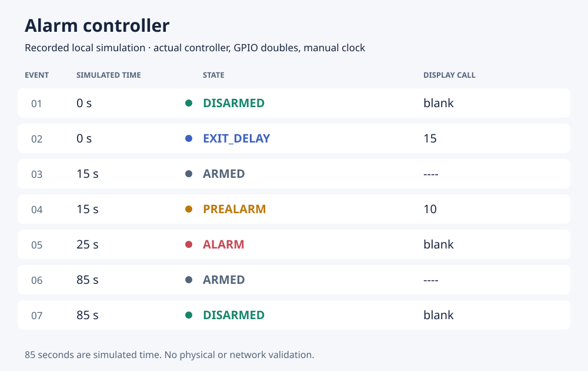

# Raspberry Pi Alarm Controller

An electronics coursework prototype combining three sensor inputs, a five-state
controller, a two-digit PIN, an RGB LED, a buzzer and a four-digit display.
Telegram notifications are optional and disabled by default. The local demo
exercises the controller without requiring a Raspberry Pi.



The trace above comes from a local execution of the controller. It shows the
arming delay, a triggered sensor, the prealarm and alarm, automatic rearming,
and a correct PIN returning the controller to the disarmed state. All times are
simulated; physical hardware and notification delivery have not been validated.

## Run the local demo

Python 3.12; tested with 3.12.14. Only the standard library is required.
From this folder:

```bash
python main.py --simulate
python simulate.py --json results/simulated_run.json
python -m unittest discover -s tests -v
```

Reproduce the trace image with `python tools/render_simulation.py`. The renderer
calls the existing simulator and records its state and display outputs; it needs
only the standard library.

Simulation substitutes GPIO interfaces, advances the clock explicitly and always
disables Telegram. It uses actual controller functions and a fictitious PIN of
42; it does not simulate electrical behaviour. The JSON command replaces the
named output. [Saved results](results/simulated_run.json) traverse
`DISARMED → EXIT_DELAY → ARMED → PREALARM → ALARM → ARMED → DISARMED`.
The trace's 85 seconds are simulated time, not measured hardware duration.

## Controller

| State | LED | Buzzer | Display |
|---|---|---|---|
| Disarmed | Steady green | Silent | Blank or entered PIN |
| Exit delay | Accelerating blue flashes | Accelerating beeps | 15-second countdown |
| Armed | Off | Silent | `----` or entered PIN |
| Prealarm | Steady orange | Repeated short beeps | 10-second countdown or PIN |
| Alarm | Flashing red | Alternating 2/4 kHz siren | Blank or entered PIN |

A sensor threshold moves the armed controller into prealarm. After 10 seconds
it enters alarm, then rearms after 60 seconds. A correct PIN disarms from any
of these three states. Confirmation is checked before automatic transitions can
reset the digits. The PIN is chosen when arming and kept in memory; two visible
digits are a teaching mechanism, not strong access control.

The nominal scan interval is 0.1 seconds. GPIO calls, worker shutdown and
scheduling can extend it. LED and buzzer timing is not guaranteed to stay in
phase. In prealarm, a countdown tick can overwrite the displayed PIN.

## Raspberry Pi and Telegram

The intended platform is a Raspberry Pi 4 with an iMAT HAT. Check physical
wiring, voltages, sensor models, SPI setup and echo level shifting before use.
BCM connections, software thresholds and setup are in [the hardware guide](docs/hardware.md).

```bash
python -m pip install -r requirements-pi.txt
python main.py --hardware
```

Hardware installation and real GPIO/SPI, sensors, display and sound remain
**unverified**. Thresholds of 1.5 V IR, 1.0 V microphone deviation and 0.50 m
ultrasonic change are software settings, not measured detection performance.
Hardware mode has no simulation fallback.

To enable Telegram, export credentials from a private `.env` and use
`--hardware --enable-telegram`, following [the hardware guide](docs/hardware.md).
The program does not load `.env` automatically. Delivery is asynchronous, with a
five-second timeout and no guarantee of arrival; no real Telegram delivery has
been checked.

This is an educational prototype, without validated security, supervised restart
or power-loss protection.

## Tests and version notes

The test command above runs 14 tests covering the state path, PINs at transition
boundaries, digit wraparound, sensor thresholds/priority, countdown cancellation,
TM1637 encoding, shutdown and mocked HTTP success/errors. GPIO is replaced by
doubles; these checks do not establish electrical reliability.

Post-submission corrections removed embedded credentials, isolated countdown
cancellation and made PIN confirmation take priority over automatic state
changes. The five states, timings and sensor thresholds are retained.

## Academic context and credits

An *Electronic Systems* team project completed by two students, iMAT, ICAI,
Universidad Pontificia Comillas.
Hardware access uses gpiozero and RPi.GPIO. The
adapted TM1637 driver retains its [third-party attribution](THIRD_PARTY.md) and
[MIT notice](LICENSES/TM1637-MIT.txt).
