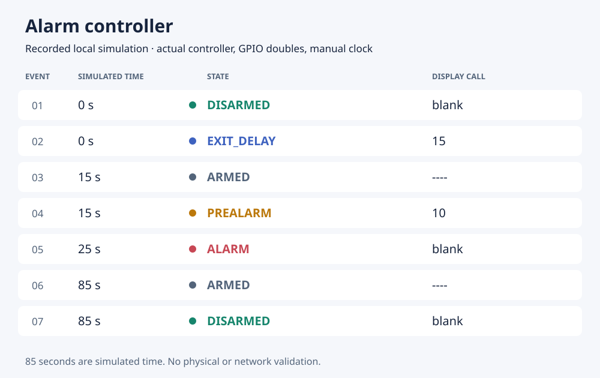

# Raspberry Pi alarm demo

An Electronic Systems coursework prototype with three sensor inputs, a
five-state controller, a two-digit PIN, an RGB LED, a buzzer and a four-digit
display. We built it as a two-student project. The repository includes a local
simulation that runs the controller without a Raspberry Pi.

[Run the simulation](#how-to-run) · [States](#controller-behaviour) · [Code](#repository-structure) · [Hardware](#raspberry-pi-and-telegram)

<a href="docs/assets/simulated-state-trace.svg"></a>

This saved trace shows arming, a triggered sensor, prealarm, alarm, automatic
rearming and a correct PIN returning to disarmed. The clock and GPIO are
simulated; the 85 seconds shown are not measured hardware time.

## How to run

Use Python 3.12. Only the standard library is needed. If your interpreter is
named `python3.12` rather than `python`, use that command below. Run from the
project folder:

```bash
python main.py --simulate
python simulate.py --json demo-output/simulated-run.json
```

The simulator calls the controller with GPIO doubles and a fictitious PIN of
42. It advances time explicitly and never enables Telegram. The second command
writes a JSON trace, replacing that output file if it already exists. Compare it
with the [saved trace](results/simulated_run.json).

To draw a new state diagram without replacing the saved SVG:

```bash
python tools/render_simulation.py --output demo-output/simulated-state-trace.svg
```

## Controller behaviour

| State | LED | Buzzer | Display |
| --- | --- | --- | --- |
| Disarmed | Steady green | Silent | Blank or entered PIN |
| Exit delay | Accelerating blue flashes | Accelerating beeps | 15-second countdown |
| Armed | Off | Silent | `----` or entered PIN |
| Prealarm | Steady orange | Repeated short beeps | 10-second countdown or PIN |
| Alarm | Flashing red | Alternating 2/4 kHz siren | Blank or entered PIN |

A sensor threshold starts the prealarm. After 10 seconds the alarm sounds, then
the controller rearms after 60 seconds. A correct PIN disarms from armed,
prealarm or alarm; confirmation takes priority over an automatic transition.
The PIN is chosen when arming and held in memory.

## Repository structure

Start with `main.py` for the state machine and `simulate.py` for a complete
hardware-free example.

```text
raspberry-pi-alarm-demo/
├── main.py                   # Controller, transitions and sensor polling
├── simulate.py               # Hardware-free example run
├── hardware_doubles.py       # Simulated GPIO components and clock
├── buttons.py                # PIN and confirmation buttons
├── infrared.py               # Infrared input and threshold
├── microphone.py             # Microphone input and threshold
├── ultrasonic.py             # Ultrasonic distance input and threshold
├── rgb_led.py                # RGB LED component
├── buzzer.py                 # Buzzer component
├── display.py                # Four-digit display and countdown
├── tm1637.py                 # Adapted third-party display driver
├── notifications.py          # Optional Telegram requests
├── THIRD_PARTY.md            # Attribution for tm1637.py
├── LICENSES/                 # MIT notice for the display driver
├── tools/
│   └── render_simulation.py  # Trace renderer (SVG)
├── results/                  # Saved simulation output
├── tests/                    # Automated checks
├── docs/
│   ├── hardware.md           # Hardware configuration, thresholds and Pi startup
│   └── assets/               # Saved state-trace SVG
├── requirements.txt
├── requirements-pi.txt       # Raspberry Pi hardware dependencies
└── .env.example              # Placeholder Telegram settings
```

## Raspberry Pi and Telegram

The intended platform is a Raspberry Pi 4 with an iMAT HAT. The
[hardware guide](docs/hardware.md) gives BCM connections, thresholds, Pi
dependencies and startup instructions. Check the wiring, voltages, SPI and
ultrasonic echo level shifting before connecting devices.

Telegram is disabled by default. The guide explains how to supply private
credentials through environment variables; `.env` is not loaded automatically.
Notifications run asynchronously with a five-second timeout and no guaranteed
delivery.

## Tests and limits

```bash
python -m unittest discover -s tests -v
```

Tests cover transitions, PIN handling, sensor inputs, countdowns, cleanup and
mocked HTTP. The simulation does not model electrical behaviour. Physical
GPIO/SPI, sensors, display, sound and real Telegram delivery have not been
checked.

Scanning is nominally every 0.1 seconds, but hardware calls and scheduling can
extend it. LED and buzzer timing can drift, and a prealarm countdown tick can
overwrite the displayed PIN. Two visible PIN digits are a teaching mechanism;
this prototype has no validated security or power-loss protection.

Two-student coursework for Electronic Systems, iMAT, ICAI, Universidad Pontificia
Comillas. `tm1637.py` adapts a third-party driver: its
[attribution](THIRD_PARTY.md) and [MIT notice](LICENSES/TM1637-MIT.txt) are retained.
